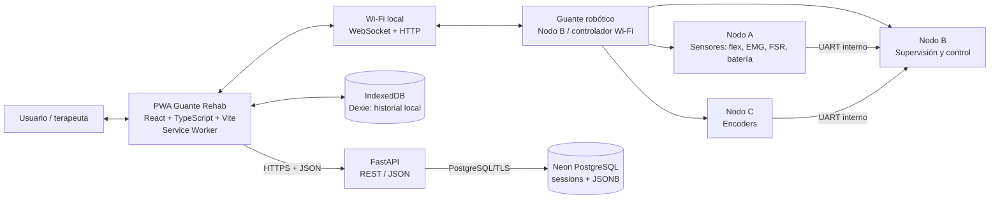
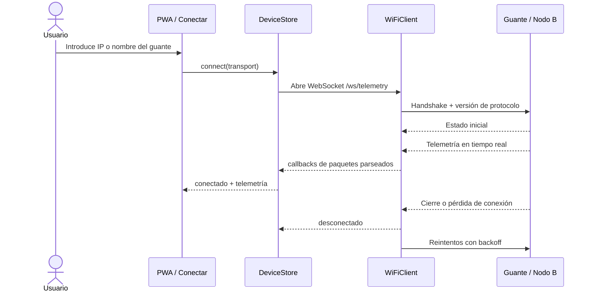
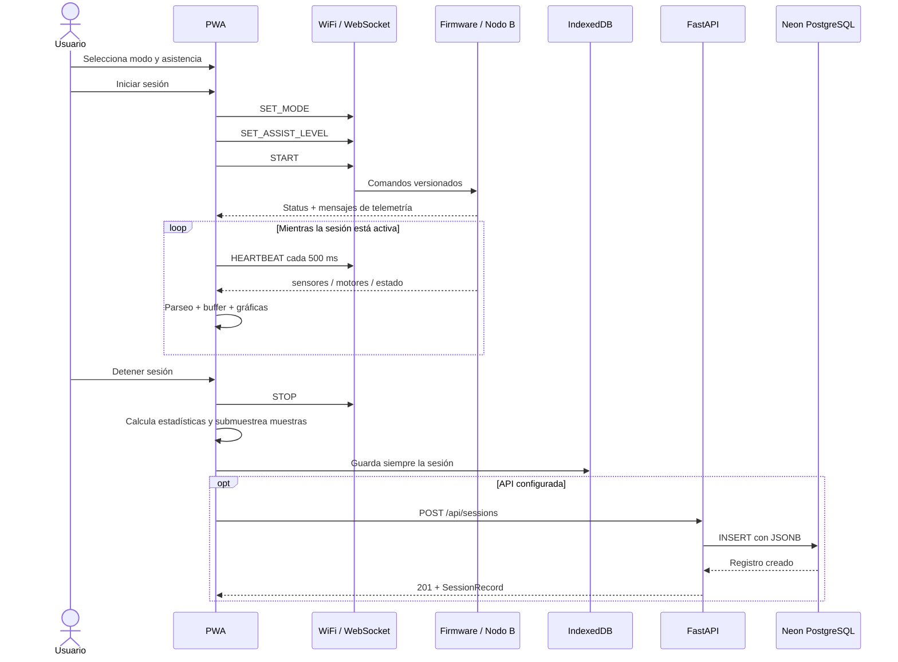
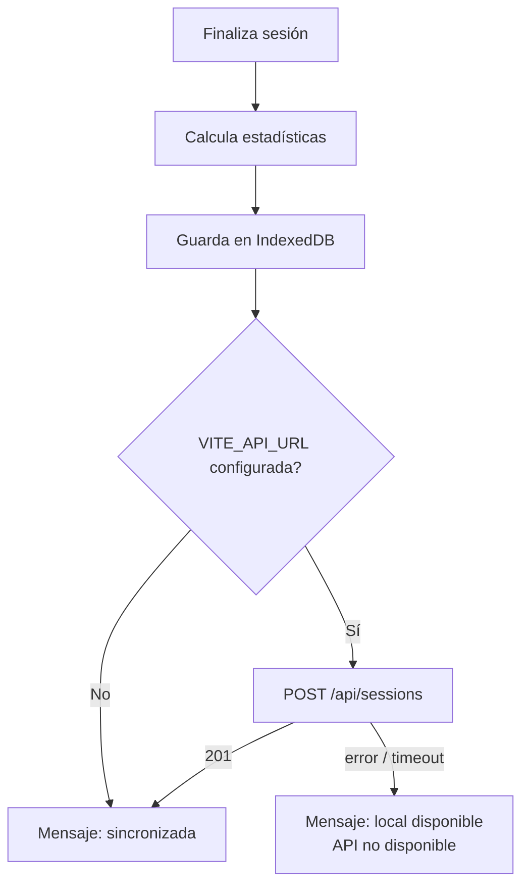
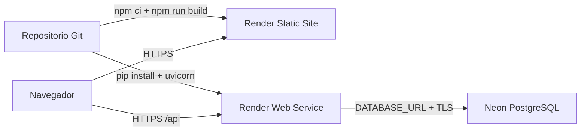

# Guante Rehab — arquitectura, algoritmos y comunicaciones

**Estado:** arquitectura objetivo con Wi‑Fi; la migración del transporte está pendiente  
**Fecha:** 2026-10-26  
**Alcance:** PWA, persistencia local, API de sincronización, base de datos y
contrato de comunicación con el firmware.

> La arquitectura objetivo usa Wi‑Fi. El repositorio todavía contiene una
> implementación anterior basada en Web Bluetooth, por lo que la migración del
> transporte y del contrato de mensajes debe realizarse antes de conectar el
> hardware final. Las partes marcadas como **pendientes**, **provisionales** o
> **no implementadas** no deben representarse como capacidades clínicas
> terminadas.

## 1. Resumen ejecutivo

Guante Rehab es una PWA construida con React, TypeScript y Vite. Su función es
servir como interfaz de configuración, calibración, monitoreo y consulta del
historial de un guante robótico de rehabilitación.

La PWA se comunicará con el guante real mediante **Wi‑Fi sobre una red IP
local**. La recomendación para la comunicación en tiempo real es WebSocket,
con HTTP REST para salud, configuración y operaciones puntuales. La telemetría
se recibirá por el canal Wi‑Fi, se validará con un contrato de mensajes
versionado, se publicará en el estado de la interfaz y se almacenará
temporalmente en un buffer circular en memoria.

Al finalizar una sesión, la aplicación:

1. Calcula estadísticas a partir de la telemetría recibida.
2. Guarda la sesión localmente en IndexedDB mediante Dexie.
3. Intenta sincronizar una copia con una API FastAPI.
4. La API valida los datos y los persiste en PostgreSQL administrado por Neon.

La arquitectura es **local-first**: la falta de API o de Internet no impide
guardar y consultar el historial local. El identificador `X-Device-Id` separa
el historial anónimo de cada instalación, pero **no es autenticación**.

## 2. Diagrama general



### 2.1 Límites de responsabilidad

| Componente | Responsabilidad | No debe hacer |
|---|---|---|
| PWA | Configurar, calibrar, iniciar/detener desde la interfaz, mostrar telemetría, registrar sesiones y exportar CSV | Ejecutar el control físico de motores o ser la única barrera de seguridad |
| Wi‑Fi + WebSocket/HTTP | Transporte IP entre navegador y dispositivo | Interpretar seguridad clínica por sí mismo |
| Nodo A | Adquirir flexión, EMG, FSR y batería; conservar/calcular datos de sensores | Controlar directamente la interfaz web |
| Nodo B | Consolidar datos, exponer el servicio Wi‑Fi, supervisar salud, estados, watchdog y seguridad | Confiar en que la PWA detectará una desconexión antes de detenerse |
| Nodo C | Adquirir conteos de encoder y enviarlos por UART a B | Comunicarse directamente con la PWA en el contrato actual |
| API FastAPI | Validar y guardar/leer sesiones remotas | Guardar credenciales en el navegador o sustituir autenticación |
| Neon PostgreSQL | Persistencia remota de sesiones | Recibir conexiones directas desde la PWA |

## 3. Capas de la solución

### 3.1 Capa de presentación y aplicación web

- **React + TypeScript:** componentes, páginas y tipos estáticos.
- **React Router:** rutas `/`, `/calibracion`, `/sesion` y `/historial`.
- **Zustand:** estado de conexión del dispositivo y estado de la sesión.
- **Vite:** servidor de desarrollo y empaquetado de producción.
- **vite-plugin-pwa:** manifest, registro del service worker y actualización
  automática.
- **uPlot:** gráficas de telemetría en vivo.
- **Tailwind/PostCSS/CSS:** estilos de la interfaz.

Archivos principales:

| Área | Archivos |
|---|---|
| Entrada y rutas | `src/main.tsx`, `src/App.tsx` |
| Transportes de la PWA | `src/wifi/wifiClient.ts` y `src/ble/webBluetoothClient.ts` |
| Contrato actual a migrar | `src/ble/gattSpec.ts`, `src/ble/types.ts`, `src/ble/parsers.ts` |
| Estado | `src/store/deviceStore.ts`, `src/store/sessionStore.ts` |
| Telemetría | `src/store/telemetryBuffer.ts`, `src/components/LiveChart.tsx` |
| Sesiones locales | `src/db/schema.ts`, `src/db/sessions.ts` |
| API remota | `src/api/sessions.ts` |
| Vistas | `src/pages/Conectar.tsx`, `Calibracion.tsx`, `Sesion.tsx`, `Historial.tsx` |

### 3.2 Capa de transporte de dispositivo

La interfaz `GloveTransport` desacopla la aplicación del medio de conexión.
Para la arquitectura Wi‑Fi debe conservarse esta abstracción y sustituirse el
transporte físico. El estado esperado es:

- `WifiClient`: conexión real por WebSocket y HTTP; el usuario proporciona IP o hostname.

La conexión Wi‑Fi debe conocer la dirección o nombre del guante, o implementar
un mecanismo de descubrimiento pendiente de definir. Una PWA no puede escanear
libremente la red local desde el navegador.

### 3.3 Capa de estado y recepción de telemetría

`useDeviceStore` mantiene:

- estado de conexión: desconectado, conectando, conectado, reconectando o
  error;
- batería, estado del dispositivo, flags y código de error;
- último número de secuencia de sensores;
- contador de paquetes perdidos.

Cada paquete recibido se agrega a `telemetryBuffer`. El componente de gráficas
lee el buffer sin escribir directamente en la base de datos.

`useSessionStore` mantiene:

- estado de sesión: inactiva, activa o emergencia;
- modo seleccionado;
- nivel de asistencia solicitado;
- tiempo de inicio;
- contador de heartbeat;
- mensaje de error de la sesión.

### 3.4 Persistencia local

Dexie crea una base IndexedDB llamada `guante-rehab` con una tabla `sessions`.
La clave primaria es incremental (`++id`) y existen índices por `startedAt`,
`mode` y `assistLevel`.

El registro local contiene:

```text
SessionRecord
├── id?
├── startedAt, endedAt, durationMs
├── mode: 0..4
├── assistLevel: 0..100
├── stats
│   ├── emgAverage
│   ├── emgMaximum
│   ├── movementRange[5]
│   └── lostPackets
└── samples[]
    ├── timestamp
    ├── flex[5]
    ├── emgEnvelope
    └── fsr
```

### 3.5 API y persistencia remota

La API se ejecuta con FastAPI y `uvicorn`. Usa `psycopg` y un pool de
conexiones para PostgreSQL. Al iniciar, si existe `DATABASE_URL`, abre el pool
y ejecuta `api/app/schema.sql`.

La tabla `sessions` contiene los metadatos principales y almacena `stats` y
`samples` como `JSONB`. Se crea un índice por `(device_id, started_at DESC)`.

## 4. Flujos principales

### 4.1 Conexión del guante



Flujo esperado del cliente Wi‑Fi:

1. Obtiene la dirección del guante por configuración manual, QR, mDNS u otro
   mecanismo que se defina.
2. Comprueba la disponibilidad del endpoint de salud por HTTP.
3. Abre el WebSocket de telemetría y comandos.
4. Ejecuta un handshake con versión de protocolo, identificación de dispositivo
   y capacidades.
5. Recibe estado, sensores y encoders por mensajes versionados.
6. Ante pérdida de conexión, marca el dispositivo como desconectado e intenta
   reconectar.

La reconexión puede conservar los retrasos `[500, 1000, 2000, 4000, 8000]` ms,
hasta cinco intentos. Este mecanismo mejora la experiencia de la interfaz,
pero no es una protección del movimiento: el firmware debe entrar por sí mismo
en `SAFE_STOP` cuando venza el watchdog.

La PWA publicada en HTTPS no debe conectarse a un endpoint local inseguro sin
resolver el problema de contenido mixto. Para producción se debe usar HTTPS/WSS
en el dispositivo, un gateway local seguro o una topología de red que permita
la conexión de forma compatible con el navegador.

### 4.2 Inicio, operación y cierre de una sesión



En la implementación actual, el inicio requiere:

- conexión en estado `conectado`;
- flag `CALIBRATED` recibido del dispositivo;
- envío ordenado de `SET_MODE`, `SET_ASSIST_LEVEL` y `START`.

El cierre envía `STOP`, marca la sesión como inactiva, calcula los resultados y
guarda localmente antes de intentar la sincronización remota.

> **Estado del firmware de fase 1:** el firmware de banco actual contiene una
> implementación anterior basada en BLE y el caso `START` todavía termina en
> una condición segura; no produce terapia ni movimiento por Wi‑Fi. La
> interfaz de sesión está preparada para la futura implementación de control,
> pero el servidor Wi‑Fi y el contrato de mensajes aún deben implementarse.

### 4.3 Historial y combinación local/remota

La pantalla de historial carga primero IndexedDB. Si existe `VITE_API_URL`,
intenta cargar también `GET /api/sessions`.

La combinación utiliza como clave lógica:

```text
`${startedAt}-${endedAt}`
```

El resultado remoto se inserta primero y el registro local después; por tanto,
si ambos tienen la misma fecha de inicio y fin, se conserva el registro local.
Si la API falla, el historial local permanece disponible.

## 5. Algoritmos implementados en la PWA

### 5.1 Parseo y validación de mensajes Wi‑Fi

En la arquitectura objetivo, el cliente Wi‑Fi debe validar cada mensaje antes
de enviarlo al estado de React. Como mínimo debe comprobar:

- JSON válido o frame binario decodificable;
- `type` conocido y `version` compatible;
- arreglos `flex` y `encoderCounts` con cinco elementos;
- `seq` y `timestamp` presentes;
- rangos de modo, asistencia, estado, batería y flags;
- comandos con `requestId` y parámetros válidos.

El parser heredado `src/ble/parsers.ts` verifica longitudes fijas de 18, 20 y 4
bytes, pero corresponde al transporte anterior. Debe sustituirse por un parser
de mensajes Wi‑Fi o mantenerse únicamente como adaptador binario si se decide
transportar frames binarios por WebSocket.

### 5.2 Detección de paquetes perdidos

El firmware debe incrementar `seq` en cada mensaje de telemetría. Para Wi‑Fi se
recomienda `uint32`; si se conserva el contador `uint16` heredado, la PWA debe
usar la misma lógica modular. En forma general, para un contador de `N` bits:

```text
difference = (currentSeq - previousSeq + 2^N) % 2^N

si 1 < difference < 2^(N-1):
    perdidos = difference - 1
si no:
    perdidos = 0
```

El umbral de media vuelta evita confundir un salto muy grande o un reinicio con
una pérdida normal. El total se acumula en `useDeviceStore.lostPackets` y se
guarda en las estadísticas de la sesión.

### 5.3 Buffer circular de telemetría

`TelemetryBuffer` usa una capacidad predeterminada de 2048 puntos.

- `add()` escribe en `writeIndex` y avanza con módulo `capacity`.
- Cuando se llena, sobrescribe el punto más antiguo.
- `latest()` devuelve el último punto.
- `toArray()` devuelve los puntos en orden cronológico.
- `clear()` se ejecuta al iniciar una nueva conexión.

El buffer limita el uso de memoria y permite que las gráficas funcionen en
tiempo real sin crear una escritura IndexedDB por cada mensaje Wi‑Fi.

### 5.4 Submuestreo al guardar una sesión

Los mensajes de sensores objetivo deben llegar aproximadamente a 50 Hz. Al
cerrar la sesión, la PWA conserva un punto de muestra cada cinco puntos:

```text
samples = sensorPoints.filter((_, index) => index % 5 === 0)
```

La frecuencia aproximada almacenada es 10 Hz, mientras que las estadísticas de
EMG y el conteo de pérdida usan todos los puntos disponibles en el buffer.

### 5.5 Estadísticas de sesión

Para todos los puntos de sensores de la sesión:

```text
emgAverage = suma(emgEnvelope) / cantidad_de_muestras
emgMaximum = máximo(emgEnvelope)
movementRange[dedo] = máximo(flex[d dedo]) - mínimo(flex[d dedo])
lostPackets = contador acumulado del DeviceStore
```

Si no hay muestras, `emgAverage`, `emgMaximum` y cada componente de
`movementRange` se guardan como `0`.

Los valores de flexión, EMG y FSR se consideran lecturas de ADC del contrato
actual. La conversión a grados, fuerza o unidades clínicas todavía debe
definirse con la calibración y el hardware reales.

### 5.6 Heartbeat y supervisión de comunicación

Mientras la sesión está activa y la conexión está disponible, la PWA ejecuta
un intervalo de 500 ms:

```text
counter = (counter + 1) & 0xff
send WebSocket({ type: "heartbeat", counter })
```

El heartbeat solo informa que la interfaz sigue viva. El firmware debe mantener
un watchdog independiente que:

1. reinicie su temporizador cuando reciba un heartbeat válido;
2. detenga motores y deshabilite potencia al vencer el timeout;
3. publique `SAFE_STOP` y un código de error cuando sea posible;
4. no reanude automáticamente después de una pérdida.

El timeout exacto debe validarse en hardware. La documentación de firmware
propone un valor configurable inicial de aproximadamente 1000–1500 ms.

### 5.7 Reconexión Wi‑Fi con backoff

Ante cierre del WebSocket, timeout o error de red, el cliente:

1. marca la conexión como perdida;
2. cierra el socket y descarta los listeners antiguos;
3. notifica al estado de la interfaz;
4. intenta reutilizar la dirección o nombre configurado;
5. espera con backoff exponencial acotado;
6. repite el handshake y valida la versión del protocolo;
7. termina en error después de cinco intentos.

La reconexión no reanuda la sesión ni la asistencia por sí sola.

### 5.8 Validación y normalización

- modo: entero entre `0` y `4`;
- asistencia: entero entre `0` y `100`;
- el store limita la asistencia con `Math.max(0, Math.min(100, level))`;
- arreglos de flexión y rango de movimiento: exactamente cinco valores;
- API: validación adicional con Pydantic y restricciones SQL;
- comando inválido Wi‑Fi: debe producir error y no mover motores.

### 5.9 Calibración

La UI expone cuatro pasos y envía un comando por paso:

1. `CAL_EMG_BASELINE`: EMG en reposo.
2. `CAL_EMG_MVC`: contracción voluntaria máxima.
3. `CAL_FLEX_OPEN`: postura abierta de los cinco dedos.
4. `CAL_FLEX_CLOSED`: postura cerrada de los cinco dedos.

La UI espera flags de estado para pasos que requieren confirmación. El firmware
es quien valida rangos, ruido, persistencia y seguridad. Solo con el flag
`CALIBRATED` la PWA permite iniciar la sesión.

### 5.10 Algoritmo adaptativo

El algoritmo adaptativo de asistencia **no está implementado en la PWA**. La
PWA únicamente envía:

- modo solicitado (`0..4`);
- nivel solicitado (`0..100`).

El control adaptativo, el filtrado de EMG, la traducción de esfuerzo a ayuda,
las rampas, los límites por dedo, el anti-windup y el paro seguro deben vivir
en el firmware del controlador. El valor recibido por el firmware siempre debe
estar sujeto a límites físicos y clínicos independientes de la UI.

## 6. Protocolo Wi‑Fi entre la PWA y el guante

### 6.1 Protocolo seleccionado para la arquitectura objetivo

La comunicación recomendada es híbrida:

| Canal | Protocolo | Uso |
|---|---|---|
| Tiempo real | WebSocket sobre TCP; `wss://` en producción | Telemetría, estados, comandos, heartbeat y confirmaciones |
| Operaciones puntuales | HTTP REST; `https://` en producción | Salud, información del dispositivo, configuración y diagnóstico |
| Red interna del guante | Wi‑Fi 2.4 GHz o la banda validada por el hardware | Transporte IP entre el navegador y el Nodo B |
| Nodo A ↔ Nodo B / Nodo C ↔ Nodo B | UART con framing y CRC | Transporte interno de sensores, encoders y órdenes |

WebSocket es adecuado para telemetría continua porque mantiene una conexión
bidireccional. HTTP REST se conserva para operaciones que no requieren un flujo
persistente. El contrato debe incluir versión, `requestId`, `seq` y timestamp.

El servidor Wi‑Fi debe ejecutarse en el Nodo B o en un gateway local que pueda
supervisar el Nodo B. La PWA no se conecta directamente a los nodos A o C.

### 6.2 Descubrimiento y conexión

El mecanismo de descubrimiento aún debe definirse. Opciones posibles:

- dirección IP introducida por el usuario;
- nombre mDNS, por ejemplo `guante-rehab.local`;
- código QR con hostname, puerto y huella del dispositivo;
- gateway local que conozca al guante y exponga un único endpoint.

El navegador no puede escanear libremente todos los dispositivos de la red
local. Por ello, el flujo debe recibir una dirección o un nombre válido antes de
abrir la conexión.

Endpoints propuestos para el Nodo B:

| Método | Ruta | Uso |
|---|---|---|
| `GET` | `/device/health` | Salud, versión, estado y disponibilidad |
| `GET` | `/device/info` | Identidad, capacidades y versión de protocolo |
| `GET` | `/device/config` | Configuración no sensible |
| `PUT` | `/device/config` | Actualizar parámetros permitidos |
| `POST` | `/device/command` | Comando puntual o fallback sin WebSocket |
| `WS` | `/ws/telemetry` | Canal bidireccional en tiempo real |

### 6.3 Handshake WebSocket

El cliente debe iniciar el canal con un mensaje `hello`:

```json
{
  "type": "hello",
  "protocol": "wifi-v1",
  "clientId": "instalacion-local",
  "requestedRateHz": 50
}
```

El Nodo B responde con `hello_ack` y no debe aceptar comandos antes del
handshake:

```json
{
  "type": "hello_ack",
  "protocol": "wifi-v1",
  "deviceId": "guante-001",
  "firmwareVersion": "0.1.0",
  "capabilities": ["telemetry", "calibration", "heartbeat"],
  "state": 0
}
```

Si la versión no es compatible, el servidor responde `error`, cierra el canal
de forma controlada y no habilita motores.

### 6.4 Mensajes de telemetría y estado

La representación inicial recomendada es JSON UTF‑8 por WebSocket para facilitar
las pruebas. Si el ancho de banda o la frecuencia lo requieren, el mismo
contrato puede migrarse a frames binarios versionados sin cambiar la interfaz
`GloveTransport`.

Mensaje de sensores y encoders:

```json
{
  "type": "telemetry",
  "version": 1,
  "seq": 1024,
  "timestamp": 1761494400123,
  "flex": [1200, 1300, 1400, 1500, 1600],
  "emgEnvelope": 480,
  "fsr": 720,
  "encoderCounts": [12, 18, 21, 19, 16],
  "state": 4,
  "batteryPct": 87
}
```

Mensaje de estado:

```json
{
  "type": "status",
  "version": 1,
  "state": 4,
  "errorCode": 0,
  "flags": 7,
  "timestamp": 1761494400123
}
```

El servidor debe publicar `status` al conectar, después de cualquier cambio de
estado o error y cuando cambien flags relevantes. `seq` debe incrementarse en
cada muestra y no reutilizarse para otro propósito.

### 6.5 Comandos y confirmaciones

Los comandos se envían por WebSocket con `requestId` para poder asociar la
respuesta con la acción que originó la PWA:

```json
{
  "type": "command",
  "version": 1,
  "requestId": "c7f4b0d2",
  "command": "SET_ASSIST_LEVEL",
  "level": 50
}
```

Confirmación:

```json
{
  "type": "ack",
  "requestId": "c7f4b0d2",
  "command": "SET_ASSIST_LEVEL",
  "accepted": true,
  "state": 4
}
```

Comandos del contrato lógico:

| Comando | Parámetro | Validación |
|---|---|---|
| `SET_MODE` | `mode` | entero `0..4` |
| `SET_ASSIST_LEVEL` | `level` | entero `0..100` |
| `START` | ninguno | calibrado, salud válida y sin fallo latched |
| `STOP` | ninguno | siempre deshabilita motores |
| `ESTOP` | ninguno | prioridad máxima |
| `CAL_EMG_BASELINE` | ninguno | inicia calibración EMG |
| `CAL_EMG_MVC` | ninguno | inicia calibración MVC |
| `CAL_FLEX_OPEN` | ninguno | guarda postura abierta |
| `CAL_FLEX_CLOSED` | ninguno | guarda postura cerrada |
| `HEARTBEAT` | `counter` | contador módulo 256 o la versión definida |

El firmware debe validar el tipo, la versión, la longitud lógica, el rango y el
`requestId`. Un comando inválido responde con `accepted: false`, publica un
`errorCode` y no mueve motores.

### 6.6 Heartbeat y cierre de conexión Wi‑Fi

La PWA envía un mensaje de heartbeat cada 500 ms mientras la sesión está activa:

```json
{
  "type": "heartbeat",
  "counter": 7,
  "timestamp": 1761494400123
}
```

El firmware debe tener un watchdog independiente del navegador. El cierre del
WebSocket, la pérdida de heartbeats o la pérdida de comunicación con los nodos
internos debe llevar el sistema a `SAFE_STOP`. No se debe reanudar el
movimiento automáticamente al restablecer la red.

### 6.7 Compatibilidad con el contrato anterior

Los archivos `src/ble/*` y `firmware/nodeB/ble_service.h` representan el
transporte anterior y no deben considerarse la arquitectura final. Las
estructuras de datos (`flex[5]`, `emgEnvelope`, `fsr`, estado, batería,
encoders, flags y errores) sí pueden conservarse como modelo lógico al migrar a
mensajes Wi‑Fi.

Los paquetes de 18, 20 y 4 bytes eran restricciones del transporte BLE. En
Wi‑Fi ya no existe ese límite; aun así, conviene mantener campos estables,
versionados y con tamaños razonables para evitar sobrecarga y ambigüedad.

Estados actuales:

| Valor | Nombre | Significado |
---:|---|---|
| 0 | `IDLE` | Reposo; motores deshabilitados |
| 1 | `CALIBRATING` | Rutina de calibración |
| 2 | `PASSIVE` | Movimiento pasivo o asistencia mínima |
| 3 | `ASSISTED` | Asistencia configurada |
| 4 | `ADAPTIVE` | Lazo adaptativo |
| 5 | `SAFE_STOP` | Estado seguro por fallo, paro o pérdida de comunicación |

Flags:

| Bit | Máscara | Nombre |
---:|---:|---|
| 0 | `0x0001` | `CALIBRATED` |
| 1 | `0x0002` | `EMG_OK` |
| 2 | `0x0004` | `MOTORS_ENABLED` |
| 3 | `0x0008` | `LOW_BATTERY` |

### 6.5 Comandos — opcode

| Opcode | Comando | Bytes adicionales | Validación |
---:|---|---|---|
| `0x01` | `SET_MODE` | modo | `0..4` |
| `0x02` | `SET_ASSIST_LEVEL` | nivel | `0..100` |
| `0x03` | `START` | ninguno | calibración, salud y seguridad |
| `0x04` | `STOP` | ninguno | deshabilita motores |
| `0x05` | `ESTOP` | ninguno | prioridad máxima |
| `0x06` | `CAL_EMG_BASELINE` | ninguno | inicia calibración EMG |
| `0x07` | `CAL_EMG_MVC` | ninguno | inicia calibración MVC |
| `0x08` | `CAL_FLEX_OPEN` | ninguno | guarda postura abierta |
| `0x09` | `CAL_FLEX_CLOSED` | ninguno | guarda postura cerrada |
| `0x0A` | `HEARTBEAT` | contador `uint8` | módulo 256 |

Ejemplos:

```text
SET_MODE adaptativo       01 04
SET_ASSIST_LEVEL 50       02 32
START                      03
STOP                       04
ESTOP                      05
CAL_EMG_BASELINE           06
CAL_EMG_MVC                07
CAL_FLEX_OPEN              08
CAL_FLEX_CLOSED            09
HEARTBEAT contador 7       0A 07
```

## 7. Protocolo UART interno del firmware

Este enlace no lo usa directamente la PWA, pero forma parte de la arquitectura
del guante y explica cómo se consolida la telemetría antes de publicarla por
Wi‑Fi.

Todos los frames tienen la forma:

```text
A5 5A | type | length | payload[length] | crc16_le
```

- `A5 5A`: sincronización.
- `type`: tipo de mensaje.
- `length`: tamaño del payload, máximo 64 bytes.
- `payload`: datos little-endian.
- `crc16_le`: CRC-16/CCITT-FALSE sobre `type`, `length` y `payload`.

| Tipo | Dirección | Payload |
---:|---|---|
| `0x10` | A → B | payload de sensores de 18 bytes + calidad, error, flags y batería mV |
| `0x11` | C → B | cinco conteos `int32` de encoder, 20 bytes |
| `0x12` | B → A | opcode de calibración, 1 byte |
| `0x13` | B → A | orden de clutch: `0` suelto, `1` acoplado |

El parser UART puede alimentarse byte a byte, rechaza longitudes inválidas y
descarta frames con CRC incorrecto. B usa timeouts para determinar si A o C
dejaron de publicar; una falla debe llevar el sistema a `SAFE_STOP`.

## 8. Estados y seguridad

La seguridad primaria está en el firmware, no en la aplicación web.

Condiciones que deben producir `SAFE_STOP`:

- `ESTOP` o paro físico;
- pérdida de heartbeat;
- pérdida o cierre de la conexión Wi‑Fi/WebSocket;
- pérdida de comunicación con A o C;
- sensor inválido o saturado;
- encoder o UART inválido;
- batería críticamente baja;
- falla de driver, sobrecorriente, sobretemperatura o límite mecánico.

El estado seguro queda retenido en el firmware actual. `STOP` y un heartbeat
posterior no deben borrar una falla latched automáticamente.

Cadena de parada del firmware:

1. PWM a cero y `STBY LOW`.
2. Liberación del clutch.
3. Motores deshabilitados.
4. Publicación de estado y código de error.
5. Recuperación únicamente mediante una acción explícita y validaciones de
   salud.

La PWA muestra el estado y ofrece el botón de emergencia, pero no puede
garantizar que el navegador, el sistema operativo o el enlace inalámbrico estén
disponibles en una emergencia.

## 9. API HTTP y protocolo de sincronización

### 9.1 Transporte

- protocolo: HTTP REST;
- formato: JSON;
- producción: HTTPS;
- backend: FastAPI + Uvicorn;
- CORS: restringido mediante `FRONTEND_ORIGINS`;
- identificación de instalación: header `X-Device-Id`;
- no se usan credenciales de Neon en el frontend.

La PWA genera el identificador una sola vez con `crypto.randomUUID()` y lo
guarda en `localStorage` bajo `guante-rehab-device-id`. Si no existe, usa un
fallback basado en tiempo y aleatoriedad.

### 9.2 Endpoints

| Método | Ruta | Uso |
|---|---|---|
| `GET` | `/api/health` | Estado de la API y disponibilidad de la base de datos |
| `POST` | `/api/sessions` | Crear una sesión remota |
| `GET` | `/api/sessions` | Listar sesiones del `X-Device-Id`, máximo 200 por consulta |
| `GET` | `/api/sessions/{id}` | Obtener una sesión del mismo dispositivo |

En `POST` se envía un `SessionRecord` sin `id`. La API valida:

- `durationMs >= 0`;
- `mode` entre `0` y `4`;
- `assistLevel` entre `0` y `100`;
- `movementRange` con cinco valores;
- `flex` con cinco valores;
- `lostPackets >= 0`.

Un `GET` de una sesión solo devuelve registros cuyo `device_id` coincide con el
header recibido. Si no hay `DATABASE_URL`, los endpoints de sesiones responden
con servicio no disponible; la PWA conserva la copia local.

### 9.3 Flujo local-first



La sincronización no bloquea el guardado local. Actualmente no existe una cola
de reintento en segundo plano para sesiones pendientes; si el `POST` falla, la
sesión permanece local y podrá consultarse o exportarse desde la PWA.

## 10. Despliegue



### Static Site

```text
Build: npm ci && npm run build
Publish directory: dist
Rewrite: /* -> /index.html
Variables: VITE_API_URL
```

### Web Service

```text
Root directory: api
Build: pip install -r requirements.txt
Start: uvicorn app.main:app --host 0.0.0.0 --port $PORT
Variables: DATABASE_URL, FRONTEND_ORIGINS
Health check: /api/health
```

`DATABASE_URL` solo debe existir en el Web Service. Nunca debe utilizarse como
variable `VITE_*`, porque las variables `VITE_*` pueden terminar en el bundle
del navegador.

## 11. Seguridad y alcance clínico

La aplicación actual está diseñada para desarrollo y demostración. Antes de
usar datos de pacientes o realizar una prueba clínica faltan, como mínimo:

- cuentas y autenticación;
- autorización por paciente, terapeuta y organización;
- auditoría de accesos y cambios;
- cifrado y política de retención de datos;
- consentimiento y trazabilidad clínica;
- protección contra replay o suplantación del `X-Device-Id`;
- validación del algoritmo adaptativo con hardware y cargas controladas;
- límites físicos, corriente, temperatura y recorrido verificados;
- pruebas de desconexión, heartbeat, batería y paro físico.

El `X-Device-Id` únicamente separa instalaciones anónimas. No demuestra la
identidad del usuario ni protege por sí mismo los datos.

## 12. Pendientes y decisiones que deben confirmarse

1. Implementación del servidor Wi‑Fi en el Nodo B o en un gateway.
2. Protocolo final: WebSocket, REST, formato JSON o frames binarios.
3. Descubrimiento: IP manual, mDNS, QR o gateway local.
4. TLS/WSS, autenticación y autorización del dispositivo.
5. Procedimiento clínico de calibración EMG/MVC.
6. Conversión de ADC a grados, fuerza y unidades clínicas.
7. Algoritmo adaptativo y límites de asistencia.
8. Timeout exacto de heartbeat.
9. Frecuencias reales de sensores, motores y encoders.
10. Tabla final de códigos de error.
11. Límites mecánicos, corriente y temperatura por dedo.
12. Cola de reintento o reconciliación de sesiones no sincronizadas.
13. Comportamiento final de `START` cuando se habilite la terapia.

## 13. Fuentes de verdad en el repositorio

| Documento / archivo | Contenido |
|---|---|
| `README.md` | Ejecución, despliegue y visión general |
| `AGENTS.md` | Registro técnico actualizado y variables de entorno |
| `FIRMWARE.md` | Contrato heredado, estados, seguridad, calibración y pendientes |
| `src/ble/gattSpec.ts` | Contrato heredado de longitudes, opcodes, flags y estados |
| `src/ble/parsers.ts` | Parser heredado de paquetes binarios |
| `src/ble/webBluetoothClient.ts` | Transporte Bluetooth alternativo; comparte el contrato con Wi‑Fi |
| `src/store/deviceStore.ts` | Recepción, estado de dispositivo y pérdida de paquetes |
| `src/store/telemetryBuffer.ts` | Buffer circular de telemetría |
| `src/pages/Sesion.tsx` | Heartbeat, ciclo de sesión y estadísticas |
| `src/db/schema.ts` | Modelo IndexedDB/Dexie |
| `src/api/sessions.ts` | Cliente HTTP remoto |
| `api/app/routes.py` | Endpoints FastAPI |
| `api/app/models.py` | Validación Pydantic |
| `api/app/schema.sql` | Esquema PostgreSQL |
| `firmware/docs/UART_PROTOCOL.md` | Protocolo UART interno |
| `firmware/docs/SAFETY.md` | Reglas de seguridad implementadas |

## 14. Texto breve para acompañar el diagrama

Guante Rehab utiliza una arquitectura distribuida de tres niveles. En el
primer nivel, la PWA React funciona como interfaz de usuario y cliente Wi‑Fi:
configura el guante, recibe telemetría por WebSocket, muestra gráficas y
conserva el historial localmente. En el segundo nivel, el firmware del guante
consolida sensores y encoders mediante UART, ejecuta la supervisión de
seguridad y publica un servicio Wi‑Fi con HTTP y WebSocket. En el tercer nivel,
una API FastAPI recibe opcionalmente las sesiones por HTTPS y las almacena en
PostgreSQL/Neon. El diseño local-first permite operar y conservar datos sin
conexión a la nube; la sincronización remota es complementaria.
El control adaptativo y las protecciones críticas pertenecen al firmware, no a
la PWA.
